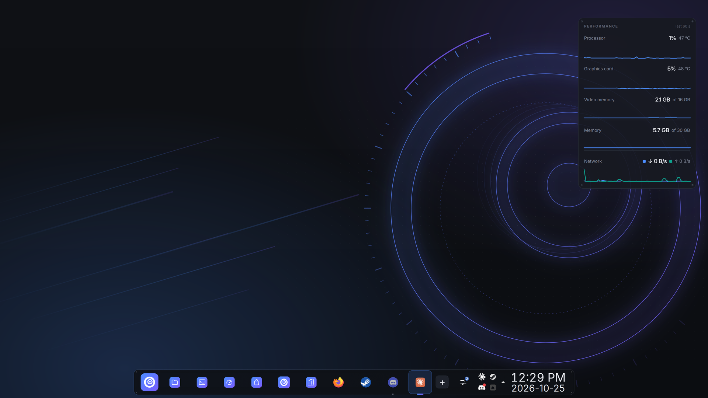
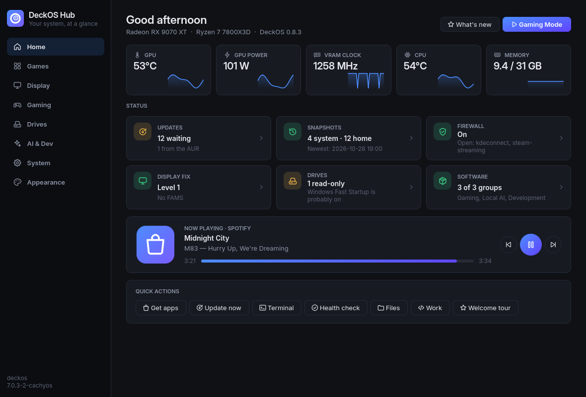

<div align="center">

# DeckOS

**One PC for gaming, building and local AI, without them fighting over the hardware.**

Arch Linux · CachyOS-optimised packages · KDE Plasma 6 · Steam Gaming Mode · On-device AI

[Get DeckOS](#get-deckos) · [Install](#install) · [What's different](#why-deckos) · [Known limitations](#known-limitations)




<table><tr>
<td width="50%"></td>
<td width="50%"><b>DeckOS Hub</b><br>Live temperatures and clocks, updates, snapshots, the firewall, drives and software in one place, with Gaming Mode a click away.</td>
</tr></table>

</div>

---

DeckOS is a desktop Linux distribution for people who play games and build things on the same machine.
It pairs a fast, CPU-optimised Arch base with a polished KDE Plasma desktop that switches into a
console-style Steam **Gaming Mode**, a private AI assistant that runs on your own graphics card, and a
suite of first-party tools that coordinate all three. When a game starts, the AI steps out of video
memory and background work pauses; when the game ends, everything comes back.

**Built for** PC gamers on AMD Radeon who also code, stream or run local models; people moving from
Windows who want Steam, their library and their existing drives to work on day one; and anyone who wants
Arch's speed without assembling and babysitting it by hand.

## Why DeckOS

Most gaming distributions tune the kernel and ship Steam. DeckOS goes further: it treats the whole PC,
games, development and AI, as one system, and ships its own tools to keep that system healthy.

| | |
|---|---|
| **Workload modes** | The PC reacts to what you're doing. Launch a game and AI models are unloaded from VRAM, Docker pauses and indexing stops; quit and it's all restored |
| **Game Doctor** | When a game closes right after launch, DeckOS reads Steam's and Proton's logs, explains the cause in plain language and offers one-click fixes, every one of them undoable |
| **DeckOS Assistant** | Press Meta+Space and ask your PC to install, configure or explain something. It runs locally on your GPU, needs no account or subscription, and shows every change before making it |
| **DeckOS Bench** | CPU, memory, disk, graphics, AI and game benchmarks with confidence ranges, history and A/B comparisons, so tuning decisions are measured rather than guessed |
| **Updates you can undo** | A btrfs snapshot before every update, and one-click Undo in DeckOS Hub (or `deckos undo`) if something breaks. Older snapshots boot straight from the boot menu |
| **A safe installer** | Installs beside Windows without touching Windows drives, refuses BitLocker and in-use partitions, and installs itself in a VM in CI before every release |
| **Move in from Windows** | Finds your Windows drives, Steam libraries and files and brings them across; Windows itself is only ever read |
| **Fixes for real hardware** | A step-by-step fix ladder for the RX 9000 DisplayPort blackouts on high-refresh monitors, dual-boot clock correction and Steam libraries on NTFS |
| **Its own desktop apps** | DeckOS Files, Terminal, Editor, Hub, Store, Menu, Quick Settings, System Monitor and System Doctor: one consistent design, built for this system |
| **Make it yours** | Eight themes, 28 wallpapers and five layouts: dock, classic taskbar, top bar, auto-hiding dock, or a big-screen layout for the couch |

### How it's made

DeckOS is designed and maintained by one person, **kcooperlawson**, building with AI assistance: the
apps, installer, themes and tools in this repository were written together with Claude (Anthropic's AI,
through Claude Code) and ChatGPT, then tested on real hardware and in CI. Commits made with AI help say so.

| | |
|---|---|
| **Base** | Arch Linux + CachyOS repos built for your CPU (x86-64-v3, v4 or Zen 4), `linux-cachyos` (BORE) + `linux-cachyos-lts` fallback |
| **Desktop** | KDE Plasma 6 (Wayland) with the DeckOS look: its own Plasma style, login screen and icons (Papirus with DeckOS-blue folders), Inter + JetBrains Mono. An optional TMpikes theme comes along |
| **DeckOS Hub** | one app for live stats, the display fix, Gaming Mode, drives, AI and dev tools, updates, snapshots, the firewall, adding software and changing the look |
| **DeckOS Store** | one app store for the Arch and CachyOS repos, Flathub and the AUR: browse, search and install with a click |
| **Gaming** (optional) | Steam, **Gaming Mode** (gamescope session, SteamOS-style switching), Proton-CachyOS, MangoHud, GameMode, LACT, Lutris, Heroic, `xone` for the Xbox Wireless Adapter, NTSync, Discord, OBS |
| **Local AI** (optional) | Ollama for running models on your graphics card: ROCm on a Radeon, CUDA on NVIDIA |
| **Development** (optional) | Claude Code, VS Code, JetBrains Toolbox, Docker, Node, Python/uv, .NET, Java, gh |
| **Disks** | btrfs with snapshots: boot an older snapshot from GRUB after a bad update. Existing NTFS drives stay NTFS and are mounted read/write |
| **Fixes** | Display blackout fix ladder for Radeon cards (`deckos display`), Windows dual-boot clock, Steam libraries on NTFS |

## DeckOS Bench

DeckOS Bench is a native app for running system and game benchmarks, browsing historical
performance charts, and comparing saved sessions. Open `deckos-bench` for the interface or use
`deckos bench` in a terminal. Reports export as self-contained HTML files. See [Bench usage and validation status](docs/bench.md).

## Game Doctor

When a game closes within 45 seconds of starting, a notification offers to look into it. **Game Doctor**
reads what the game printed in Steam's log (its Proton and Wine output), tells you in plain words what
went wrong (the local model explains it, and known problems are matched: anti-cheat, a missing Windows
library, the DirectX-to-Vulkan layer failing, a crash, sync problems, .NET, memory) and offers fixes that
fit, each one click and each undoable:

- run the game with another Proton version (DeckOS's Proton-CachyOS, or Proton Experimental)
- the OpenGL path (`PROTON_USE_WINED3D=1`) or no fast sync (`PROTON_NO_FSYNC=1 PROTON_NO_NTSYNC=1`)
- a fresh Proton prefix (the old one is kept and can come back)
- Steam checking the game files

Fixes that change Steam's settings close Steam for a moment (it rewrites those files when it exits) and
reopen it. Open it any time from Hub › Games › Game Doctor, or `deckos game doctor [APPID]`. Anti-cheat
that blocks Linux is said plainly: no setting on the PC changes that.

## DeckOS Work (in development)

A dedicated local workspace for code, files, documents and images, using the models already in
DeckOS Assistant. Saved project chats, reversible edits, approved terminal commands, office-format
outputs and Stable Diffusion image generation. No hosted-model credits; setup downloads models and
an isolated creation runtime. See [usage, setup and current limits](docs/work.md).

## Requirements

| | |
|---|---|
| **CPU** | Any 64-bit x86 CPU. Packages are optimised for whatever level your CPU supports |
| **GPU** | **AMD Radeon** recommended: it's what DeckOS is tested on. NVIDIA and Intel drivers are picked by CachyOS's hardware detection (`chwd`) but are untested so far ([limitations](#known-limitations)). Local AI needs a Radeon RX 7000 / 9000 (ROCm) or an NVIDIA card (CUDA) |
| **Firmware** | UEFI with **Secure Boot off** |
| **Disk** | **64 GB or more** (150 GB+ if games go on it too): unallocated space, an empty disk, or a spare partition |
| **Memory** | 8 GB minimum, 16 GB recommended |
| **Internet** | Wired or Wi-Fi during the install: packages are downloaded fresh |

## Get DeckOS

The ISO is built on Arch Linux. Pick one:

**A. GitHub Actions (nothing to install).** Fork this repo, then go to *Actions › Build DeckOS ISO ›
Run workflow*. When it finishes (~30 min), download the `deckos-iso` artifact.

**B. An Arch machine, or WSL on Windows.** On Windows, in an admin terminal:
`wsl --install -d archlinux`, reboot, then inside Arch:

```bash
sudo pacman -Syu --needed archiso git
```

```bash
sudo ./build.sh
```

The ISO lands in `out/`, named after the release in `VERSION` (for example `deckos-0.3.0-x86_64.iso`).

**Write it to a USB stick** with [Ventoy](https://www.ventoy.net) (copy the ISO onto the stick),
[Rufus](https://rufus.ie) (pick *DD Image mode* when asked) or `dd`. Boot it from your firmware's
boot menu (usually F11, F12 or F8 right after power-on) and pick the UEFI entry.

## Before you install

If DeckOS is going next to Windows, do this in Windows first:

1. **Make room.** Open *Disk Management*, right-click a drive with free space › *Shrink Volume*, and leave
   the space unallocated: the installer makes DeckOS's partition there itself. (A spare partition works
   too, and so does an empty second disk.)
2. **Turn off Fast Startup.** Open Terminal **as Administrator** and run `powercfg /h off`. Fast Startup
   leaves NTFS drives half-hibernated, and Linux will only mount them read-only.
3. **BitLocker.** Linux can't read BitLocker drives, and the installer won't offer a BitLocker partition
   as a target. Check *Settings › Privacy & security › Device encryption*.
4. **Secure Boot off** in your firmware settings (usually under *Security* or *Boot*).

## Install

The USB boots straight into the **DeckOS desktop** (logged in as `liveuser`, no password). Try things
first (Wi-Fi, your monitors, DeckOS Hub), then double-click **Install DeckOS**:

1. **Welcome** checks UEFI mode, Secure Boot and internet. Connect to Wi-Fi from here if needed.
2. **Where** lists the partitions, free space and empty disks DeckOS can go on. A partition you pick is
   erased; in free space (64 GB or more, on a GPT disk) or on an empty disk DeckOS makes its own partition
   and erases nothing, and an empty disk gets its own boot partition too. Nothing existing is ever moved
   or resized. Partitions it can't safely check (BitLocker, encrypted, in use, part of a RAID) are shown
   greyed out with the reason, and a partition that holds Windows is always refused.
3. **You**: username, computer name, language, keyboard layout, password and time zone. The live
   desktop switches to your keyboard layout right away, so the password you type is the one that works
   at login.
4. **Software**: tick Gaming, Local AI and/or Development. The desktop, kernel, graphics drivers and
   snapshots are always installed. Local AI starts unticked if no Radeon RX 7000/9000 or NVIDIA card is
   found.
5. **Confirm**: read the summary, tick the box, *Erase and install* (just *Install* in free space or on an empty disk).
6. **Install** shows progress and the live log. It takes 20–60 minutes, depending on your internet.

Behind the scenes it installs Arch from mirrors in your time zone's country, switches to the CachyOS repos for your CPU, installs the desktop and
the groups you picked (the DeckOS package and AUR apps come prebuilt on the USB), mounts your NTFS drives under
`/mnt/<drive label>`, takes a "fresh install" snapshot and sets up GRUB with DeckOS, Windows and a
snapshots menu. The EFI partition is shared with Windows and never formatted. It also picks the
[display fix level](#display-blackouts-on-radeon-cards) for your GPU and monitors, and keeps the
hardware clock in local time only if it finds Windows, so the clock is right in both. The firewall
(firewalld) is on, blocking incoming connections except KDE Connect and, with Gaming, Steam Remote Play.
If an install fails, the message says exactly what was changed so far. The log is saved to `/var/log/deckos-install.log`. If the install fails, the log is copied to
the live desktop. A text-mode installer (`sudo deckos-install`) is in the app menu as a backup.

## First login: DeckOS Welcome

The first time you log in, **DeckOS Welcome** walks through what most people change right away. Every
step is optional and applies as you go:

| Step | What's there |
|---|---|
| **Look** | global theme (DeckOS, TMpikes), light or dark, accent colour, wallpaper, Plasma style and icons |
| **Display** | scale per screen, a shortcut to arranging them, and the [blackout fix](#display-blackouts-on-radeon-cards) level with the one recommended for your setup picked |
| **Software** | add Gaming, Local AI or Development if you skipped them, and one-click Spotify, Discord, OBS, VS Code and more |
| **Gaming** | Gaming Mode's resolution and refresh rate (matched to your screen in one click), VRR and HDR, Steam libraries on Windows drives, the Xbox Wireless Adapter |
| **Your files** | hourly snapshots of your home folder, a backup drive, your Windows drives |
| **Privacy & updates** | the update channel, checking for updates, the firewall |
| **Extras** | the DeckOS look for Spotify, Claude Code, KDE Connect and a keyboard shortcut cheat sheet |

It ends with a summary of what changed (and whether a restart is needed). After that it stays out of
the way: open it again from the app menu, **DeckOS Hub › Home › Welcome tour**, or `deckos-welcome`.
Tick *Show at startup* to have it back at every login.

## System Doctor

**System Doctor** (DeckOS Hub's Health check, or `deckos sysdoctor`) says what's wrong with the PC right now,
worst first, in plain words: services that failed, programs that crashed (named by what ran, and a burst of
desktop crashes recognised as one event), graphics card resets, programs a system rule needs but that
aren't installed, a slow start-up, a full disk, a restart an update is waiting for. Each finding shows the
log lines it's based on, offers its fix (asking for your password when it changes the system) or the
DeckOS app that handles it (Game Doctor, the Hub's display fix), and **Explain** asks the local AI what it
means, on your graphics card, so nothing leaves the PC. `deckos doctor` is still the full report.

## Move in from Windows

**Move in from Windows** (DeckOS Hub › Drives, the Welcome tour, or `deckos movein`) finds the Windows
on this PC and brings over what's worth having, in one go:

- your Windows **folders** (Documents, Pictures, Downloads, OneDrive…) in DeckOS Files' sidebar, read
  straight from the Windows drive, nothing copied;
- your **wallpaper**; your **Firefox** profile (bookmarks, history, passwords, add-ons) as Firefox's
  profile here; **Edge or Chrome bookmarks** as a file Firefox imports;
- your **Steam games** as libraries in Steam here, so nothing downloads again (and Proton's files go on
  the Linux drive); other launchers' game folders, with how to add them to Heroic or Lutris;
- a DeckOS match for **your apps**, each with a Get button; fonts you installed;
- and it makes your Windows drives mount at every start, so none of that vanishes after a restart.

Windows itself is never changed; anything changed on the DeckOS side keeps a `.deckos-bak`. Wi-Fi
passwords can't come over: Windows encrypts them.

## Display blackouts on Radeon cards

Some Radeon cards (confirmed on the RX 9070 XT) save power at idle by switching their VRAM clock with
firmware help (FAMS). With a high-bandwidth monitor (the Samsung Odyssey G7 at 4K 144 Hz is the known
case), especially alongside a second screen, each switch can drop the DisplayPort signal for 1–2 seconds.
DeckOS has a fix ladder you can climb if it happens to you. The installer starts you at **level 1** if it
finds an RX 9070-series card driving a Samsung Odyssey or more than one monitor, and at level 0 otherwise
(the live USB always runs level 1):

| Level | What it does | Cost |
|---|---|---|
| 0 | stock AMD behaviour | — |
| 1 | `amdgpu.dcdebugmask=0x20000`: no SubVP/FAMS memory-clock switching | small idle power |
| 2 | + VRAM clock pinned to max at boot | ~15–30 W idle |
| 3 | + no multi-monitor clock switching, no PSR / Panel Replay | same |
| 4 | + every GPU clock forced high | most idle power / heat |

```bash
sudo deckos display set 2
```

Or use **DeckOS Hub › Display**, then reboot. If you're on level 1 and never see blackouts,
`sudo deckos display set 0` gets the idle power back. `deckos display recommend` shows what the installer
would pick for your setup. To find the cause, run `deckos display watch` (also a button in the Hub) and
press Enter each time the screen blinks. It logs VRAM clock changes, kernel display messages and
hotplugs, so the cause shows up right next to your marker.

Still flickering on level 3+? It's probably the monitor or cable:
- In the monitor's menu: update the firmware, turn **Adaptive-Sync/FreeSync off**, turn off automatic
  source switching.
- Use the DisplayPort cable that came with the monitor (or a VESA-certified DP 1.4 one).
- Gaming Mode ships with VRR **off** for the same reason. Turn it on in the Hub once things are stable.

Sources: [Bazzite #4934](https://github.com/ublue-os/bazzite/issues/4934),
[Arch BBS 311159](https://bbs.archlinux.org/viewtopic.php?id=311159),
[`amd_shared.h` DC_DEBUG_MASK](https://github.com/torvalds/linux/blob/master/drivers/gpu/drm/amd/include/amd_shared.h).

## DeckOS Hub

The DeckOS Hub (in the panel, or `deckos hub`) is where DeckOS's own settings live:

| Page | What's there |
|---|---|
| **Home** | live GPU, VRAM, CPU and memory graphs; status of updates, snapshots, firewall, display fix, drives and software, each a click away; **Now Playing** with album art, seek and controls for Spotify, Firefox or any media player |
| **Display** | the blackout fix ladder with the level recommended for your setup, your monitors, and the blackout watcher |
| **Gaming** | Gaming Mode, its resolution, refresh rate, VRR and HDR, plus LACT, GOverlay, ProtonUp-Qt and the Steam-on-NTFS fix |
| **Drives** | your Windows drives with how full they are, and help when one is read-only |
| **AI & Dev** | Claude Code, Ollama (start/stop, your models) and which dev tools are installed |
| **System** | updates with a progress bar (AUR apps in the terminal), system and home snapshots, backup to another drive, the firewall, and adding Gaming, Local AI or Development later |
| **Appearance** | global theme (DeckOS, TMpikes), accent colour, wallpaper, Plasma style, icons, and the DeckOS look for Spotify |

**Spotify in the DeckOS look:** install Spotify from the DeckOS Store, open it once and log in, then
press *Apply DeckOS look* in **Hub › Appearance** (or run `deckos spotify theme`). It uses
[Spicetify](https://spicetify.app) to restyle the official app with DeckOS colours, bordered panels and
the gradient play buttons; everything Spotify does keeps working. Spotify updates undo it, so apply it
again after one; `deckos spotify restore` puts the stock look back.

## Quick Settings

The sliders button in the panel opens **DeckOS Quick Settings**, the everyday controls in one popup:

- **Wi-Fi, Bluetooth, Do not disturb and Night light** tiles (the arrow on a tile opens its settings page)
- **Volume** for your default output, or every output with the arrow; **brightness** for each screen
  that can be dimmed (laptop panels, and monitors that support DDC/CI)
- **Now playing** with controls for Spotify, Firefox or any media player
- **DeckOS**: Gaming Mode, the [display fix level](#display-blackouts-on-radeon-cards) (pick a new one
  right there; it applies after a restart), the firewall, the power profile and, on laptops, the battery
- **Updates**: how many are waiting, with *Update now* (opens Hub › System and starts the update). The
  panel button shows the count as a badge; the check runs in the background every few hours

It uses Plasma's own services for Wi-Fi, sound and the rest, so it opens instantly and does nothing
while it's closed. On an existing install, add it with right-click on the panel › *Add or Manage Widgets*.

## Workload modes

A PC that games, builds code and runs local AI has them fighting over the same graphics card. When a
game starts (Steam, Lutris, or Gaming Mode), DeckOS gets out of its way:

- **Ollama's models leave graphics memory**, so the game gets all of it. Ollama loads them again the
  next time something asks for one.
- **Docker containers pause**, and carry on where they were when the game ends. Label a container
  `deckos.keep=true` (a game server, say) to keep it running.
- **File indexing pauses** until the game ends.

A notification says what was freed, and Quick Settings shows it while you play. `deckos mode off` turns
it off (`deckos mode on` brings it back). To keep one part running, set `OLLAMA=keep`,
`DOCKER=leave` or `BALOO=leave` in `~/.config/deckos/modes.conf`.

## DeckOS Assistant (local AI)

Ask your PC to install or set something up, in plain words. It runs on your own graphics card with
Ollama: no account, nothing leaves the PC.

**Press Meta+Space anywhere** for the chat box. It's also in DeckOS Menu (type a question, then *Ask
DeckOS Assistant*), the ✦ button in Quick Settings, DeckOS Hub › AI & Dev, and DeckOS Terminal (select
an error, press Ctrl+Shift+A). Esc hides it and the conversation stays; ↻ starts a new one. In a
terminal, `deckos ask "install OBS and set it up for streaming"` does the same, and `deckos ask` on its
own starts a conversation. It looks around by itself (what's installed, your
hardware, logs, `deckos doctor`), installs from the same places as DeckOS Store (repos first, then
Flathub, then the AUR), and adds DeckOS's Gaming, Local AI and Development groups. **Every change is
shown to you first** with the exact command (in the chat box, a card with *Do it* / *Not now*), and only runs if you say yes; root still asks for your
password. Wiping disks or home folders is refused outright.

First time (after adding Local AI): `sudo deckos ai setup` downloads the model (gpt-oss:20b, 13 GB:
the one that handled DeckOS's tools best on a 16 GB card; gemma4:12b is the lighter choice) and keeps
models out of system snapshots. `deckos ai` shows what's running; `deckos ai model gemma4:12b` switches.

**With Claude Code:** `deckos ai claude-link` gives Claude Code a `deckos-local` tool that hands long
logs, build output and big files to the local model and gets back only the lines that matter, so
those cost Claude a few hundred tokens instead of the whole file. While a game runs, the model stays
unloaded and Claude reads things itself.

## DeckOS Menu

The app launcher at the left of the dock (or press **Meta**) is DeckOS Menu. Start typing right away:
results cover apps, files, settings, a calculator and commands (Plasma's own search), and when a search
matches apps you don't have yet, they're listed from the DeckOS Store with a **Get it** button. Arrows
move, Enter opens, Escape clears or closes.

Without a search it shows your pinned apps (right-click any app to pin, unpin or move it), your recent
apps and files, **All apps** by category, and a footer with Gaming Mode, lock, log out, sleep, restart
and shut down. On an older install that still has Plasma's launcher, right-click it › *Show
Alternatives…* › *DeckOS Menu*.

## DeckOS Store

The DeckOS Store (in the app menu, or `deckos-store`) installs apps without the command line, from all
three places DeckOS gets software:

- **Arch and CachyOS repos**: installed with pacman, updated with the rest of the system. Preferred
  when an app is available from more than one place.
- **Flathub**: apps that aren't in the repos (Spotify, Bottles…), sandboxed, updated by `deckos update`.
- **AUR**: community packages, searched live and built with paru. Labelled, since Arch doesn't check them.

It has editor's picks and categories on the home page, one search across all three sources, app pages
with screenshots and a choice of source, and an Installed list. App details come from the AppStream
catalogs Arch and Flathub publish; repo installs ask for your password, Flathub ones don't.

## DeckOS Terminal

DeckOS Terminal (in the dock, or `deckos-terminal`) is the default terminal. Each tab is named after
the project it's in, with its git branch and whatever is running (`deckos ⎇ main · cargo build`), and
while a game runs a chip in the corner says what workload modes freed for it.

| | |
|---|---|
| Ctrl+Shift+T / Ctrl+Shift+W | new tab in the same folder / close the pane (the tab, when it's the last one) |
| Ctrl+Shift+D / Ctrl+Shift+E | split right / split down; Alt+arrows move between the panes |
| Ctrl+PgUp/PgDn, Alt+1…9 | switch tabs |
| Ctrl+C / Ctrl+V | copy (when text is selected; otherwise Ctrl+C stops the program, as always) / paste |
| Ctrl+Shift+C / V / F | copy / paste / find; right-click has them too, plus Open link and Ask DeckOS Assistant |
| Ctrl+Shift+A | ask DeckOS Assistant about the selected text (an error, a command) |
| Ctrl+= / Ctrl+- / Ctrl+0 | bigger / smaller / normal text |

**Snapshot first:** before a big delete (`rm -rf ~/Documents`, a whole git repository, `sudo rm -r` of
system files), the shell asks whether to take a snapshot first, in any terminal. Afterwards it says how
to undo it: `deckos restore N` puts the files back straight away; a system delete goes back with
`sudo deckos undo N` and a restart. In DeckOS Terminal an Undo bar under the pane does either for you. `rm -rf build/` and other everyday deletes don't ask.
`deckos snapshot-first off` turns it off.

Konsole stays installed for anyone who prefers it (System Settings › Default Applications › Terminal).

## Using it

| | |
|---|---|
| `deckos` / **DeckOS Hub** | everything below in one place |
| `deckos software add gaming` | add a software group you skipped at install (`gaming`, `ai` or `dev`) |
| **Gaming Mode** | panel launcher, or pick *DeckOS Gaming Mode* on the login screen. Back: Steam › Power › *Switch to Desktop* |
| `deckos steam-ntfs` | run once after adding a Steam library that lives on a Windows drive. Games stay on NTFS, Proton prefixes move to Linux |
| `deckos drives` | `list`, `rescan` (new drives), `doctor` (read-only/Fast Startup problems) |
| `deckos update` | full update; snap-pac snapshots before and after |
| `deckos updates` | how many updates are waiting (cached; `--max-age 0` checks now) |
| broken update? | reboot › *DeckOS snapshots* › pick the one before the update |
| deleted a file? | `/home` has hourly snapshots: copy it back from `/home/.snapshots/<number>/snapshot/` (Hub › System › Browse snapshots). Older installs: `sudo deckos home enable` |
| `deckos backup /mnt/BIG` | copy your home folder (minus caches, Steam games, ISOs) to another drive; remembered for next time |
| `deckos doctor` | health check: kernel, display fix, drives, snapshots, AI |
| `claude` | Claude Code, installed for your user (`~/.local/bin`) |
| `ollama run qwen3` | local models on your graphics card (ROCm on Radeon, CUDA on NVIDIA) |

**Gaming Mode resolution:** it defaults to 3840×2160 at up to 144 Hz. For a different screen, pick yours in
**DeckOS Hub › Gaming** (it's saved in `~/.config/deckos/gaming.conf`; system defaults are in
`/etc/deckos/gaming.conf`).

## Known limitations

DeckOS is early, and these are on the list:

- **NVIDIA and Intel GPUs are untested.** The installer hands them to CachyOS's `chwd`, which picks
  the driver for the card (NVIDIA's open driver on GTX 16 / RTX 20 and newer, the legacy drivers or
  nouveau on older cards, Mesa and Intel's media driver on Intel), but nobody has installed DeckOS on
  that hardware yet. If the NVIDIA driver didn't go in, DeckOS starts on nouveau: run `sudo chwd -a` and
  restart. Gaming Mode (gamescope) is less mature on NVIDIA than on AMD.
- **AMD-only extras:** the display blackout fix and DeckOS Hub's *Graphics card* tuning (power limit,
  undervolt, fan curve) work through `amdgpu` and are hidden or do nothing on other cards; LACT covers
  NVIDIA and Intel tuning. The FSR 4 upgrade needs a Radeon RX 9000. Local AI on Intel graphics runs on
  the CPU.
- **The live USB** is set up for AMD graphics; on NVIDIA it runs on nouveau, which is enough to install.
- **Disk layout:** DeckOS installs onto a partition, unallocated space on a GPT disk, or an empty disk. It
  doesn't erase or repartition a whole disk that has something on it, or resize partitions: make room in
  Windows first.
- **Secure Boot** has to stay off.

Bug reports are welcome. Please attach the output of `deckos doctor` and, for install problems,
`deckos-install.log`.

## Reference machine

Every default in DeckOS was chosen and tested on this machine:

Ryzen 7 7800X3D · Radeon RX 9070 XT · ASRock B850M-C · 32 GB DDR5-6000 · Samsung Odyssey G70B + LG UltraGear,
dual-booting Windows 11.

[docs/reference-machine.md](docs/reference-machine.md) has the exact setup for it (BIOS settings, which
partition DeckOS goes on, the drive layout).

## Development

The look shares its design language with Steady Downloader (slate `#0F1115` / `#171A21`, `#262B36`
borders, `#4C8DFF` accent), reworked mechanically: stencil letters, a thumbstick for the O (gate ring
and tilted cap), bolted plates, hazard stripes.

**DeckOS Builder** (`builder/`) is a desktop app that starts GitHub builds, downloads ISOs and copies them
to a Ventoy stick. See [builder/README.md](builder/README.md).

```
VERSION                   the DeckOS release: names the ISO, shows in os-release, the Hub and deckos doctor
builder/                  DeckOS Builder app (GitHub builds, downloads, Ventoy USB)
apps/                     DeckOS Files and DeckOS Terminal (C++/Qt 6); pkg/deckos-files, pkg/deckos-terminal package them
assets/generate.py        brand generator (wordmark, gear, wallpaper, GRUB bg)
assets/icons.py           the DeckOS line icons (Hub, Store, login screen) and the Store's app icon
assets/plasma_theme.py    the DeckOS Plasma style (panel, popups, tooltips, widgets)
assets/preview_*.py       render the Hub, Welcome, login screen, Plasma style or Quick Settings on any OS
assets/qml-stubs/         stand-ins for Plasma's QML modules, so plasmoid previews run without Plasma
build.sh                  ISO build (Arch releng profile + DeckOS)
iso/                      live-USB additions (packages, live user, autologin)
installer/                the install script, plus the language and keyboard lists it offers
pkg/deckos-settings/      Arch package: Hub, Store, deckos tool, themes, icons, fixes (rootfs/ mirrors /);
                          usr/share/deckos/packages/*.txt = what gets installed, per group
pkg/deckos-theme-tmpikes/ the optional TMpikes theme
pkg/deckos-installer/     the graphical installer (drives deckos-install)
docs/                     the reference machine's setup
.github/workflows/        lint + package test + ISO build
```

### Updates for installed systems

DeckOS's own packages (`deckos-settings` with the Hub, `deckos` tool, themes and fixes, plus
`deckos-theme-tmpikes`) are published as a signed pacman repo, on two channels:

- **Stable**, the [`repo` release](https://github.com/kcooperlawson/deckos/releases/tag/repo): where every
  install starts. It only gets a release once that release has been tried on the testing channel.
- **Testing**, the [`repo-testing` release](https://github.com/kcooperlawson/deckos/releases/tag/repo-testing):
  every release, minutes after it's tagged. `sudo deckos channel testing` switches a PC to it,
  `sudo deckos channel stable` back (`deckos channel` shows which one a PC is on).

Installed systems have the repo as `[deckos]` in `pacman.conf`, so `deckos update` and the Hub's Update
button pick up new versions like any other package.

**What's New:** a feature release (0.4.0, 0.5.0…) ships release notes in
`pkg/deckos-settings/rootfs/usr/share/deckos/releases/X.Y.Z.toml`: a name, a tagline, highlights with a screenshot
and a *Try it* button, and the fixes. After the update, DeckOS shows them once, at the next login or straight after
updating from the Hub (`deckos whatsnew` any time). Someone who skipped a release sees everything since the last one
they saw. Patch releases (0.4.1…) have no notes file, so they update quietly; their fixes go in the next notes.

**To release:** bump `VERSION`, commit, then tag and push (`git tag v0.3.1 && git push origin v0.3.1`).
CI checks that the tag matches `VERSION`, signs the packages with the DeckOS key (fingerprint
`F67E15FABF95D2DA72BE5D3F6322881773088C41`, kept as the `DECKOS_SIGNING_KEY` secret) and replaces the
testing repo's contents. Once it has run well on a testing PC, run **Promote to stable** from the Actions
tab with that version: stable gets exactly the packages testing had. It refuses when testing holds a
different version (a newer tag landed in between), so nothing reaches stable untried. `deckos-theme-tmpikes` only updates on installed systems when its own `pkgver` goes up.

**Working on DeckOS from DeckOS:** clone the repo into your home folder (not a Windows drive: NTFS loses
file permissions and symlinks), then `deckos dev-install` builds and installs your checkout. A later
release replaces it as a normal update. Installs from 0.3.0 or earlier don't have the update channel or
`dev-install` yet; run `makepkg -si` once in `pkg/deckos-settings` to get both.

`build.sh` and DeckOS Builder keep their work folder and `out/` as btrfs subvolumes of their own on DeckOS,
so system and `/home` snapshots don't hold on to old builds and ISOs.

The generators write into `pkg/` and their output is committed; run them again after changing a
design. The installer, Hub, Store and Welcome all have a demo mode for working on the UI anywhere, including
Windows: run `deckos_installer.py --demo`, `deckos_hub.py --demo`, `deckos_store.py --demo` or `deckos_welcome.py --demo` from their folders in `pkg/`.
