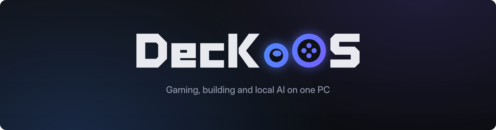
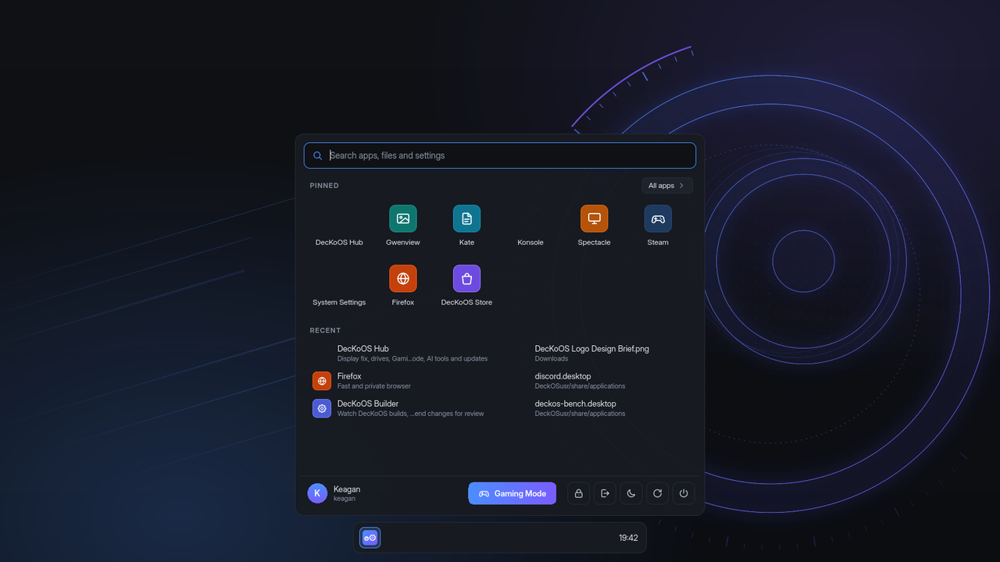
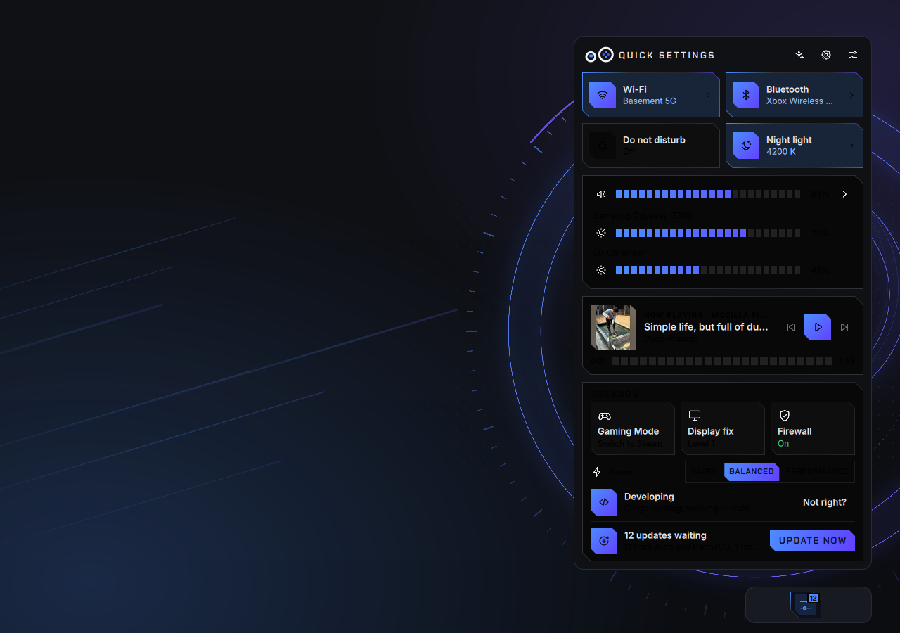
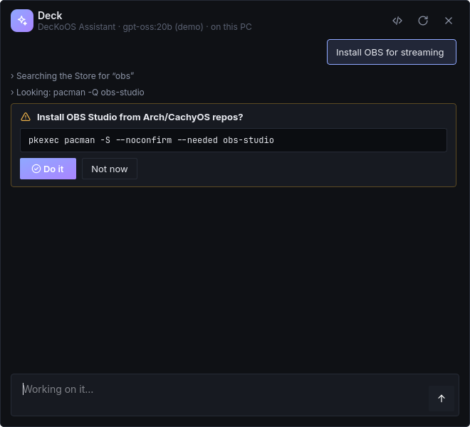
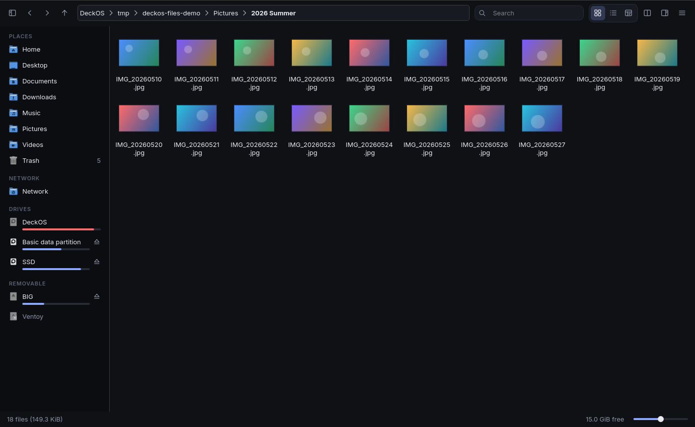
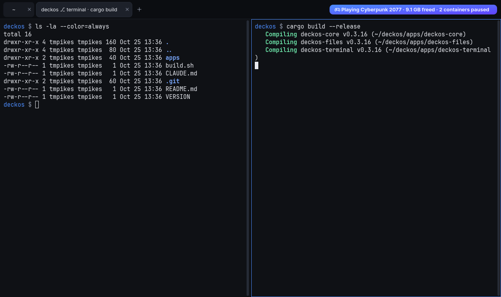
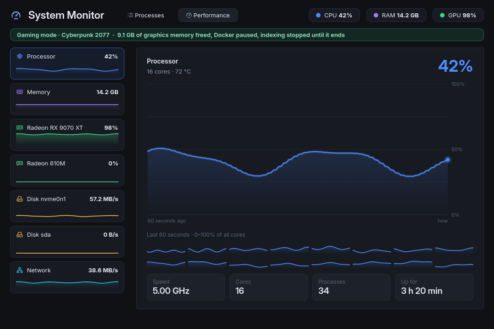
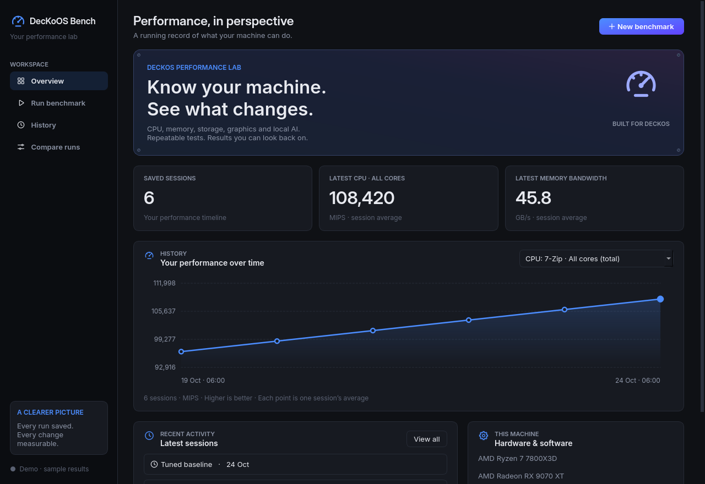

  

  
  
  
  
  

  <a href="docs/install.md"><b>Install</b></a> &nbsp;·&nbsp;
  <a href="docs/guide.md"><b>Guide</b></a> &nbsp;·&nbsp;
  <a href="#known-limitations"><b>Known limitations</b></a> &nbsp;·&nbsp;
  <a href="CHANGELOG.md"><b>Changelog</b></a> &nbsp;·&nbsp;
  <a href="CONTRIBUTING.md"><b>Contribute</b></a>

DecKoOS is a desktop Linux distribution for people who play games and build things on the same PC. A fast,
CPU-optimised Arch base and a polished KDE Plasma desktop that switches into a console-style Steam
**Gaming Mode**, a private AI assistant that runs on your own graphics card, and a suite of first-party
apps that make all of it work together. When a game starts, the AI steps out of video memory and
background work pauses; when the game ends, everything comes back.

> **New in 0.13: "Make it yours".** One-click **Vibes** (Lo-fi, Neon, Midnight, Cozy) with animated wallpapers,
> a music visualizer and desktop widgets; **Kid mode**, an account per child with only the apps you pick and a
> filtered web; DecKoOS's own **sounds**; and **every setting in one place** in DecKoOS Hub.
> [All releases →](CHANGELOG.md)

  

## Why DecKoOS

Most gaming distributions tune the kernel and ship Steam. DecKoOS treats the whole PC, games, development
and AI, as one system, and ships its own tools to keep that system healthy.

| | |
|---|---|
| **Workload modes** | The PC reacts to what you're doing. Launch a game and AI models are unloaded from VRAM, Docker pauses and indexing stops; quit and it's all restored |
| **Game Doctor** | When a game closes right after launch, DecKoOS reads Steam's and Proton's logs, explains the cause in plain language and offers one-click fixes, every one of them undoable |
| **DecKoOS Assistant** | Press Meta+Space and ask your PC to install, configure or explain something. It runs locally on your GPU, needs no account or subscription, and shows every change before making it |
| **DecKoOS Bench** | CPU, memory, disk, graphics, AI and game benchmarks with confidence ranges, history and A/B comparisons, so tuning decisions are measured rather than guessed |
| **Updates you can undo** | A btrfs snapshot before every update, and one-click Undo in DecKoOS Hub (or `deckos undo`) if something breaks. Older snapshots boot straight from the boot menu |
| **A safe installer** | Installs beside Windows without touching Windows drives, refuses BitLocker and in-use partitions, and installs itself in a VM in CI before every release |
| **Move in from Windows** | Finds your Windows drives, Steam libraries and files and brings them across; Windows itself is only ever read |
| **Fixes for real hardware** | A step-by-step fix ladder for the RX 9000 DisplayPort blackouts on high-refresh monitors, dual-boot clock correction and Steam libraries on NTFS |
| **Its own desktop apps** | DecKoOS Files, Terminal, Editor, Hub, Store, Menu, Quick Settings, System Monitor and System Doctor: one consistent design, built for this system |
| **Vibes** | A whole mood in one click: an animated wallpaper with a music visualizer that dances to what's playing, matching colours and taskbar, and desktop widgets (clock, Now Playing, weather, focus timer, note). Everything pauses in games |
| **Vibe mode** | DecKoOS Music turns every screen into one stage for whatever's playing (Spotify, a browser, your own files): the cover in the middle and one show across every monitor: an aurora with shockwaves on the beat, a 2000s spectrum analyzer, 2000s feedback trails, or a calm glow. Each Vibe picks one (and its colours); you can pick your own. More monitors, a bigger stage. Offered when music starts, or Meta+M |
| **Kid mode** | An account per child: big tiles for only the apps you pick, a family-filtered web, Retro games, time limits and bedtimes a child can't switch off. Your session stays locked underneath |
| **Every setting in one place** | DecKoOS Hub searches its own pages, DecKoOS's actions and Plasma's settings; More settings names Plasma's panels for what they do |
| **Make it yours** | Eight themes, 28 wallpapers, five layouts, your own accent colour, DecKoOS's own sounds, and the corners, text size and taskbar you like |

## A look around

<table>
  <tr>
    <td width="50%"> <b>DecKoOS Hub</b>: live stats, updates, snapshots, drives and the firewall in one place</td>
    <td width="50%"> <b>DecKoOS Menu</b>: apps, recent files and search, with Store suggestions</td>
  </tr>
  <tr>
    <td> <b>Quick Settings</b>: network, sound, Gaming Mode and the current workload mode</td>
    <td> <b>DecKoOS Assistant</b>: ask in plain words; every change is shown before it runs</td>
  </tr>
  <tr>
    <td> <b>DecKoOS Files</b>: a fast file manager with thumbnails, tabs and split view</td>
    <td> <b>DecKoOS Terminal</b>: tabs named after your project and git branch, splits</td>
  </tr>
  <tr>
    <td> <b>System Monitor</b>: what's running, and live graphs for every part of the PC</td>
    <td> <b>DecKoOS Bench</b>: benchmarks with confidence ranges, history and comparisons</td>
  </tr>
</table>

## Get started

1. **Check the requirements**: a 64-bit PC with UEFI (Secure Boot off), 64 GB free and, ideally, an AMD Radeon
   graphics card.
2. **Get the ISO**: build it on GitHub Actions with nothing to install, or on any Arch machine (WSL works).
3. **Install**: boot the USB into the live desktop, try things out, then run the installer. It installs
   next to Windows without touching your Windows drives.

The full walkthrough, including what to do in Windows first, is in **[Installing DecKoOS](docs/install.md)**.

## Documentation

| | |
|---|---|
| [Installing DecKoOS](docs/install.md) | Requirements, building the ISO, preparing Windows, the installer and the first login |
| [Using DecKoOS](docs/guide.md) | Hub, Store, Menu, Quick Settings, Gaming Mode, workload modes, the Assistant, Game Doctor and more |
| [Undo and snapshots](docs/undo.md) | How updates and big changes can be undone |
| [DecKoOS Bench](docs/bench.md), [Files](docs/files.md), [Terminal](docs/terminal.md), [Editor](docs/editor.md), [Work](docs/work.md) | How each app works, and its current limits |
| [Developing DecKoOS](docs/development.md) | Building from source, the reference machine, and how updates reach installed PCs |

## How it's made

DecKoOS is designed and maintained by one person, **kcooperlawson**, building with AI assistance: the
apps, installer, themes and tools in this repository were written together with Claude (Anthropic's AI,
through Claude Code) and ChatGPT, then tested on real hardware and in CI. Commits made with AI help say so.

| | |
|---|---|
| **Base** | Arch Linux + CachyOS repos built for your CPU (x86-64-v3, v4 or Zen 4), `linux-cachyos` (BORE) + `linux-cachyos-lts` fallback |
| **Desktop** | KDE Plasma 6 (Wayland) with the DecKoOS look: its own Plasma style, login screen and icons (Papirus with DecKoOS-blue folders), Inter + JetBrains Mono. An optional TMpikes theme comes along |
| **DecKoOS Hub** | one app for live stats, the display fix, Gaming Mode, drives, AI and dev tools, updates, snapshots, the firewall, adding software and changing the look |
| **DecKoOS Store** | one app store for the Arch and CachyOS repos, Flathub and the AUR: browse, search and install with a click |
| **Gaming** (optional) | Steam, **Gaming Mode** (gamescope session, SteamOS-style switching), Proton-CachyOS, MangoHud, GameMode, LACT, Lutris, Heroic, `xone` for the Xbox Wireless Adapter, NTSync, Discord, OBS |
| **Local AI** (optional) | Ollama for running models on your graphics card: ROCm on a Radeon, CUDA on NVIDIA |
| **Development** (optional) | Claude Code, VS Code, JetBrains Toolbox, Docker, Node, Python/uv, .NET, Java, gh |
| **Disks** | btrfs with snapshots: boot an older snapshot from GRUB after a bad update. Existing NTFS drives stay NTFS and are mounted read/write |
| **Fixes** | Display blackout fix ladder for Radeon cards (`deckos display`), Windows dual-boot clock, Steam libraries on NTFS |

## Known limitations

DecKoOS is early, and these are on the list:

- **NVIDIA and Intel GPUs are untested.** The installer hands them to CachyOS's `chwd`, which picks
  the driver for the card (NVIDIA's open driver on GTX 16 / RTX 20 and newer, the legacy drivers or
  nouveau on older cards, Mesa and Intel's media driver on Intel), but nobody has installed DecKoOS on
  that hardware yet. If the NVIDIA driver didn't go in, DecKoOS starts on nouveau: run `sudo chwd -a` and
  restart. Gaming Mode (gamescope) is less mature on NVIDIA than on AMD.
- **AMD-only extras:** the display blackout fix and DecKoOS Hub's *Graphics card* tuning (power limit,
  undervolt, fan curve) work through `amdgpu` and are hidden or do nothing on other cards; LACT covers
  NVIDIA and Intel tuning. The FSR 4 upgrade needs a Radeon RX 9000. Local AI on Intel graphics runs on
  the CPU.
- **The live USB** is set up for AMD graphics; on NVIDIA it runs on nouveau, which is enough to install.
- **Disk layout:** DecKoOS installs onto a partition, unallocated space on a GPT disk, or an empty disk. It
  doesn't erase or repartition a whole disk that has something on it, or resize partitions: make room in
  Windows first.
- **Secure Boot** has to stay off.

Bug reports are welcome. Please attach the output of `deckos doctor` and, for install problems,
`deckos-install.log`.

## License

DecKoOS's own code and artwork are [MIT licensed](LICENSE). Packages from Arch Linux, CachyOS and other
projects keep their own licenses.
